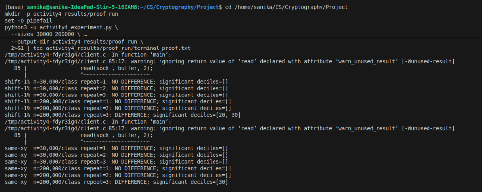
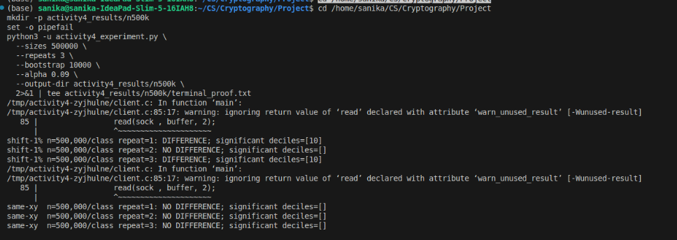

## Question and hypothesis

This experiment varies only the number of observations per class. It uses the
authors' artificial `shift-1%` timing channel and `same-xy` as a negative control.
The hypothesis is that increasing the sample size will make the small `shift-1%`
effect easier to detect, while `same-xy` should not produce a consistent detection.

## Data and storage

The official Zenodo record contains six archives totaling 38.7 GB; the measured
ground-truth archive alone is 15.8 GB. To keep the work small, this project uses the
authors' 15.7 KB `f_source_files_artificial_side_channels.zip` source component and
collects only the requested measurements locally. The archive is in `data/` (MD5:
`c74935b02c68e922de1cd8f5b9906f6e`). No Docker image or large measurement archive
is needed. [Zenodo record 10817685](https://zenodo.org/records/10817685)

The author-provided C client/server sources are modified to accept a bounded sample
count. The new Python collector and RTLF analysis are student-developed. An official
RTLF R script copy is in `tooling/rtlf.R` for reference. Since R is unavailable in
this environment, the experiment uses a Python implementation of RTLF's decision
rule: nine type-2 deciles, within-class bootstrap noise thresholds, Bonferroni
correction by `alpha/9`, and 10,000 bootstrap repetitions. It uses the beta
order-statistic identity to generate the same bootstrap quantile distribution
without allocating full resamples. See the [RTLF repository](https://github.com/tls-attacker/RTLF)
and the [paper](https://www.usenix.org/system/files/usenixsecurity24-appendix-dunsche.pdf).

## Run

Requirements: x86_64 Linux, Python 3 with NumPy, and GCC. The collector binds the
local server to TCP port 8080. Stop any service already using that port first.

The experiment was run in two batches with identical settings (`alpha = 0.09`,
10,000 bootstrap repetitions, three independent collection runs per size). Each
batch writes to its own output directory so that the summary files do not overwrite
each other.

```bash
# Batch 1: 30,000 and 200,000 observations per class
python3 -u activity4_experiment.py --sizes 30000 200000 --repeats 3 \
  --bootstrap 10000 --alpha 0.09 --output-dir activity4_results/proof_run

# Batch 2: 500,000 observations per class
python3 -u activity4_experiment.py --sizes 500000 --repeats 3 \
  --bootstrap 10000 --alpha 0.09 --output-dir activity4_results/n500k
```

Each batch writes one CSV and one RTLF JSON result per channel, size, and repeat,
plus `summary_shift1_samexy_rtlf.json` in its output directory. A 30k dataset
contains 60k timing rows; a 200k dataset contains 400k rows; a 500k dataset
contains 1,000,000 rows, which is the limit of the artifact client. The terminal
output of each batch is saved as `terminal_proof.txt` in the same directory.

## Observed result

| Channel | 30k per class | 200k per class | 500k per class |
|---|---:|---:|---:|
| `shift-1%` | 0 / 3 | 1 / 3 | 2 / 3 |
| `same-xy` control | 0 / 3 | 1 / 3 | 0 / 3 |

Entries are the number of independent runs, out of three, in which RTLF reported a
difference. The significant deciles were:

- `shift-1%`, 200k: repeat 3, deciles 20 and 30.
- `shift-1%`, 500k: repeats 1 and 3, decile 10 only.
- `same-xy`, 200k: repeat 3, decile 30 only.

For the leaking channel, detections rose from 0/3 at 30k to 1/3 at 200k and 2/3 at
500k. This is the direction the hypothesis predicts, and it agrees with the paper's
ground-truth results for a 1% shift (22.6% detection at 30k and 97.5% at 500k,
Table 2). The evidence is weak, however. With three runs per cell, the 0/3 versus
2/3 comparison between 30k and 500k is not statistically distinguishable from
chance (two-sided Fisher exact test, p ≈ 0.4), and 2/3 at 500k is well below the
paper's 97.5%. The result should be read as "consistent with the expected trend",
not as confirmation of it.

The `same-xy` control produced one detection in nine runs (200k, decile 30). With
`alpha = 0.09`, about 0.8 false alarms are expected across nine runs, so one is
compatible with the configured error rate. The control had no detections at 500k.
Three repeats per cell are too few to estimate a false-positive rate, so this
should not be reported as a measured Type-I error.

## Terminal evidence

Terminal output from the two batches. Both runs used `alpha = 0.09` and 10,000
bootstrap repetitions, with three independent collection runs per size.

**Batch 1: 30,000 and 200,000 observations per class** (`activity4_results/proof_run`)



**Batch 2: 500,000 observations per class** (`activity4_results/n500k`)



The same text output is saved as `terminal_proof.txt` in each batch's output
directory.

## Limitations

These are newly collected local timings, not a sample from the authors' measured
archive. They depend on CPU scheduling, system load, and the x86 RDTSC measurement
environment, and the two batches were collected at different times. The Python
implementation follows the published RTLF bootstrap decision rule, but the official
R tool itself was not run because R is unavailable here. Three repeats per cell are
too few to estimate detection or false-positive rates.